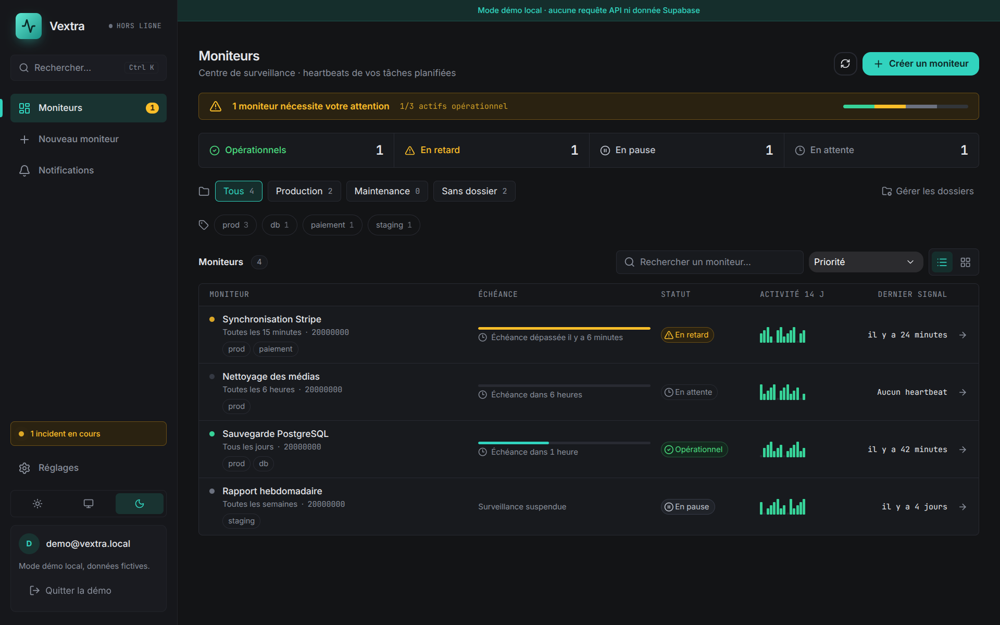

<div align="center">

# Vextra

**Sachez quand une tâche planifiée ne s'est pas exécutée, avant vos utilisateurs.**

Surveillance de _heartbeats_ pour sauvegardes, imports et jobs cron.
Libre (MIT), en équipe, hébergeable chez vous en une commande.

[Démarrage rapide](#démarrage-rapide) ·
[Fonctionnalités](#fonctionnalités) ·
[Auto-hébergement](docs/self-hosting.md) ·
[API](docs/api.md) ·
[Contribuer](CONTRIBUTING.md)



</div>

## Comment ça marche

Votre job appelle une URL de Vextra quand il se termine. Si l'appel n'arrive pas
à l'heure attendue, Vextra ouvre un incident et vous alerte. Quand le job repart,
l'incident se ferme.

Vextra ne reçoit **jamais** le contenu de vos scripts ni de vos logs : un
heartbeat est une requête vide.

## Fonctionnalités

- **Planification** : intervalle ou expression cron avec fuseau horaire, marge de
  tolérance, `start` / `success` / `fail` / `warn` avec durées et historique.
- **Alertes** : e-mail, Slack, Discord, Telegram, Teams, PagerDuty ou webhook,
  rappels tant qu'un incident reste ouvert, rapport hebdomadaire.
- **Organisation** : dossiers, tags, pauses et fenêtres de maintenance.
- **Partage** : page de statut publique avec badges SVG, équipes (propriétaire,
  membre, lecture seule) et API en lecture seule.
- **Sécurité** : isolation entre espaces par Row Level Security, tokens hachés,
  session chiffrée, limitation de débit.
  [Audit publié](docs/audits/securite-avant-production.md).

## Démarrage rapide

**1. Créez un moniteur** : choisissez la fréquence attendue et une marge. Vextra
affiche la commande à copier.

**2. Ajoutez le ping à votre job** :

```bash
0 3 * * *  /opt/scripts/sauvegarde.sh && curl -fsS -m 10 --retry 3 -X POST \
  -H "Authorization: Bearer $VEXTRA_TOKEN" https://<votre-instance>/api/ping
```

**3. Ajoutez un canal d'alerte** dans les Réglages, testez-le, c'est tout.

Pour mesurer la durée d'un job ou signaler un échec explicitement, voir la
[référence de l'API](docs/api.md).

## Auto-hébergement

Un seul conteneur Docker, relié à un projet Supabase (base et authentification) :

```bash
git clone https://github.com/samueltomen/vextra.git && cd vextra
cp .env.example .env          # URL publique, clés Supabase, deux secrets aléatoires
pnpm install && pnpm exec supabase link --project-ref <ref> && pnpm exec supabase db push
docker compose up -d --build
```

Placez ensuite un proxy HTTPS devant (Caddy, Nginx, Traefik). Le guide complet
est dans [docs/self-hosting.md](docs/self-hosting.md). Vous préférez Cloudflare ?
Voir [docs/cloudflare.md](docs/cloudflare.md).

## Développer

Prérequis : Node.js 22, pnpm 12.15.0, Docker et le CLI Supabase.

```bash
pnpm install
pnpm exec supabase start
pnpm setup:local
pnpm dev                      # interface :5173, API :8787
```

Ouvrez `http://localhost:5173/?demo=1` pour parcourir l'interface sans base.
`pnpm check` lance format, lint, types, tests et build. Les détails sont dans
[CONTRIBUTING.md](CONTRIBUTING.md).

## Documentation

[Auto-hébergement](docs/self-hosting.md) ·
[Cloudflare](docs/cloudflare.md) ·
[API](docs/api.md) ·
[Architecture et décisions](docs/README.md) ·
[Sécurité](SECURITY.md)

## Licence

[MIT](LICENSE) © Samuel Tomen
